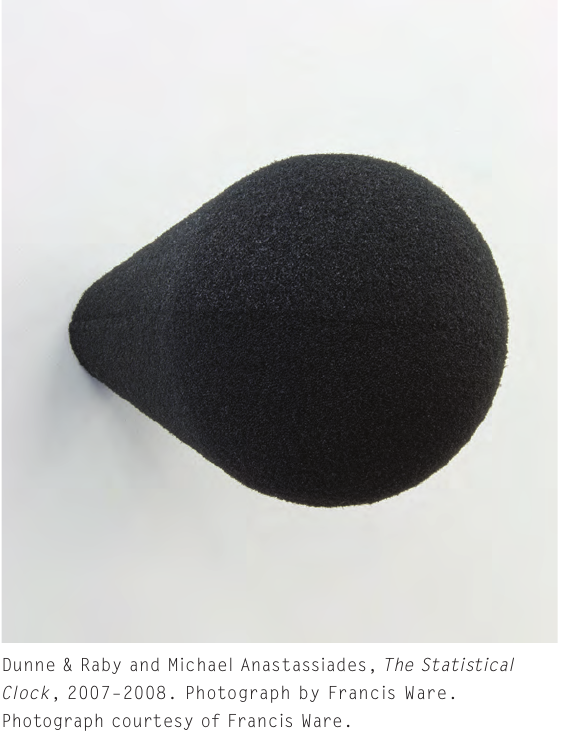
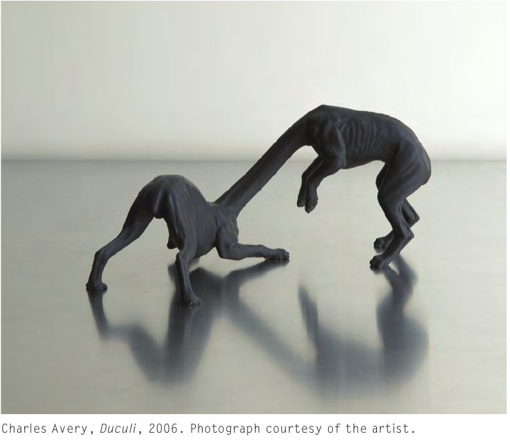
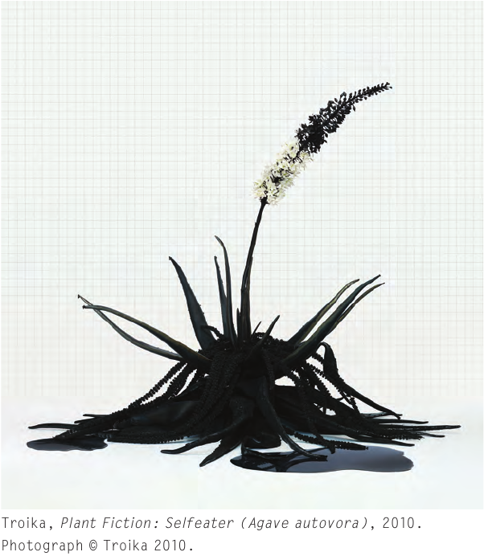
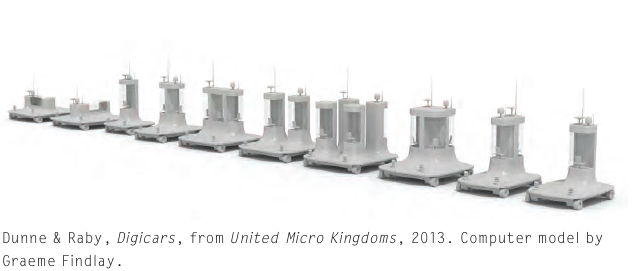
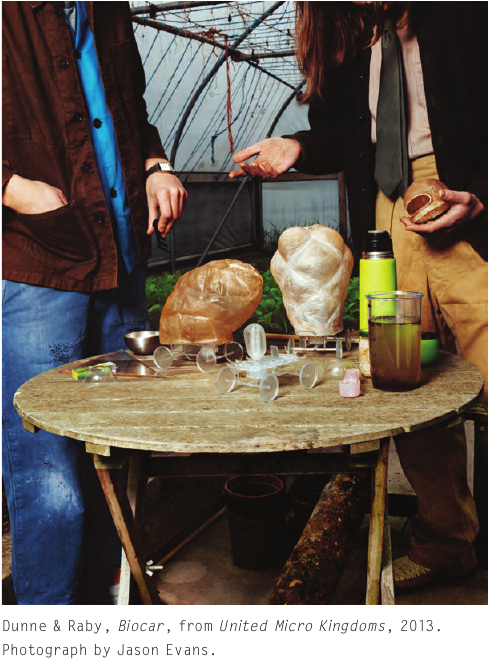
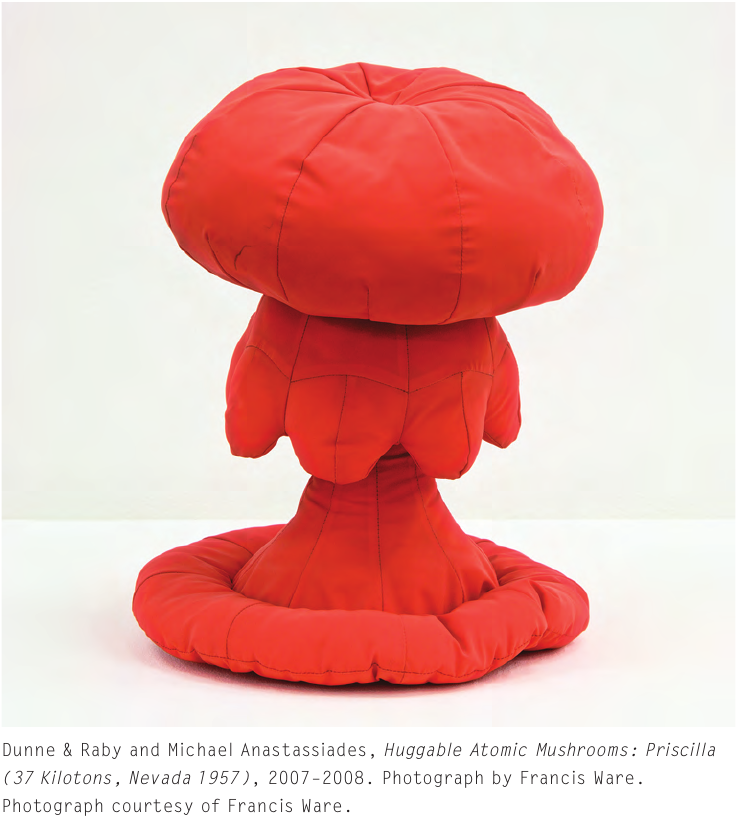

# Five-probe evaluation and initial selection

One continuous table links the activity, question, theory, speculation, feedback and decision. The table records the reasons for choosing and refining the activities.

| Probe and what people do | What we want to learn | Theory in everyday words | Where speculation enters | Feedback and making it easy to join | Decision and its basis |
| --- | --- | --- | --- | --- | --- |
| **01 · Ask About a Detail**Choose part of an object image. Say what you notice. Ask AI one question, then say what you think after its answer. **We collect:** the chosen detail, question, actual answer and any change in the visitor’s explanation.  | **After an AI answer, what does a visitor use to decide what to believe about an object?**We look for reasons, such as a visible detail, a museum source or personal knowledge. We also ask when the person checks or rejects the answer.  | A connection to an object can come from its history, appearance or a personal memory. These are different reasons. We keep them separate when reading the visitor’s account. This uses relational authenticity and the difference between looking alike and having a real source link. [1] [2] | **The book case.** The Statistical ClockThe Statistical Clock. Speculative Everything, printed p. 36. Dunne & Raby and Michael Anastassiades. Photograph by Francis Ware. [21] Figure and original caption cropped from the supplied book. Click to enlarge.The Statistical Clock is an imagined household clock that reports deaths in different kinds of transport. It takes information people may avoid and puts it into an ordinary daily object. The designers ask what kind of life would make someone want this clock. The clock helps people discuss that life. **The idea we borrow.** Put a familiar rule into a small, visible object so people can discuss how that rule shapes daily life. **How it connects to this probe.** The clock makes daily reminders visible. Probe 1 can make the rule “AI speaks first” visible through a small museum display card. The question then concerns how that rule shapes the start of a visit. **The step it changes.** After the normal question task, place the AI answer at the top of a clearly imagined museum display card. Put the visitor’s own explanation beside it. Ask what changes when the AI version always goes first. **How this helps us choose.** Keep 1 as a short introduction. A future standalone version could focus on who sets the starting point of interpretation. **The authors’ words.** What would have to change for a need like this to emerge?Dunne & Raby, printed pp. 35–36. [21] Read the quotation and case →  | The 9 October interview participant found this fairly ordinary. It has a low entry burden, but a blank question box can still be hard to use. Offer a few details to choose from and allow a short spoken question. A person can use the source card without AI. | **Keep as an introduction.**Museum AI questions can help visitors begin A or B. A separate study could focus on how the order of explanations shapes their understanding. Basis: heritage-agent attitudes and Cleveland’s Talk to the Art. [13] [23]  |
| **02 · Make with AI on My Cuff or Bag**Choose one source detail and a local cuff or bag area. Capture C1, see G1, fold or reposition the item, then compare C2 and G2. **We collect:** source choice, two approved crops, actual previews, the action between them and brief reasons.  | **What makes an adapted pattern on my item feel connected to its heritage source?**We follow a fold or position change and ask which relationship to the source matters. The person guides AI through a physical action in one small frame.  | Relational authenticity helps us ask how the visitor connects a new result to the source work. Looking similar, knowing the maker’s history and having made something yourself are separate grounds. Follow the grounds the visitor introduces. [1] [2] | **The book case.** The IslandersDuculi, from The Islanders. Speculative Everything, printed p. 93. Charles Avery, Duculi, 2006. Photograph courtesy of the artist. [21] Figure and original caption cropped from the supplied book. Click to enlarge.In Charles Avery’s The Islanders, drawings, objects, models and found bones appear to come from a traveller’s visit to an invented island. Viewers use these small clues to imagine a larger place and its way of life. A small physical thing can therefore help someone think about an imagined world. **The idea we borrow.** A small object can help people imagine the larger world in which it belongs. **How it connects to this probe.** The island’s objects make an invented place imaginable. A uses the cuff or bag preview and a future museum label to suggest a museum where heritage patterns keep entering everyday belongings. **The step it changes.** Complete A’s two local captures. Show the two actual previews beside a fictional label saying “Each version continues the original work”. Ask what kind of connection the wearable or everyday version carries forward. **How this helps us choose.** Develop A around the local material action and its two visual responses. The future label helps visitors connect their experience with a wider question about how a museum work can continue through personal use. **The authors’ words.** It is the emphasis on transporting the imagination that distinguishes them from other object types including products, prototypes, and models.Dunne & Raby, printed pp. 92–93. [21] Read the quotation and case →  | The 2 October meeting connected Probe 2 with authenticity and clothing. The 9 October interview suggested a take-away and choice about AI. The current design uses a cuff or bag corner in one fixed capture window. A plain study item and pointing offer other ways to join. | **Develop as A.**Art Morph supplies a close material-and-AI precedent. Our study follows how source-related reasons develop when visitors guide a pattern onto a personal item through two local actions. Basis: Art Morph, embodied generation, Huayao making and ZOMA. [22] [29] [30] [12] [7]  |
| **03 · Change One Detail**Select an area of an image, tell AI what may change, then compare the changed version with the source. **We collect:** selected area, instruction, actual image and reasons for keeping or rejecting it.  | **Which changes still feel connected to the object, and which changes lose that connection?**We need to hear why a change matters. Ask what the preferred picture carries from the source. The HCI issue is how people set and check limits for generation.  | The difference between resemblance and a real source link helps us separate “looks like it” from “still carries something important from it”. We also record personal preference on its own. [2] [5] | **The book case.** Plant FictionPlant Fiction: Selfeater. Speculative Everything, printed p. 95. Troika, Plant Fiction: Selfeater (Agave autovora), 2010. Photograph © Troika 2010. [21] Figure and original caption cropped from the supplied book. Click to enlarge.Troika’s Plant Fiction presents invented plants with plausible images and short texts about how they might be used in a near-future London. The plants belong to a made-up situation. The project tells viewers that it is fiction, so they can explore the situation without being told a false discovery has occurred. One example, Selfeater, is imagined to break down its own material to help make fuel. Its picture and short story let viewers think about that future use. **The idea we borrow.** Give an imagined image a clear setting and purpose, so viewers can explore the proposed future. **How it connects to this probe.** Plant Fiction explains what its invented plants would do in future London. Probe 3 needs an equally clear purpose for its changed pattern. Adapting one detail to a cuff or bag gives the change a concrete everyday use. **The step it changes.** Show the source, one local-item adaptation and a short label describing its imagined use. Ask which source detail the person wants to carry into that use and why. **How this helps us choose.** Keep 3 as a possible focused variant. A already uses a local item and visual changes. A separate Probe 3 would need its own use or research question. **The authors’ words.** There is a very important difference between inviting viewers to “make-believe” and asking them to “believe.”Dunne & Raby, printed pp. 94–95. [21] Read the quotation and case →  | The 9 October interview questioned the purpose of changing an image. The 2 October meeting’s clothing idea supplies a possible use. The current A brings that use into a two-round material interaction. | **Pause as a separate probe.**New A now includes two visual responses guided by material action. Keep Probe 3 only if a clear different use emerges, such as adapting a particular detail to clothing. Basis: TwistLens, Gen-Diaolou and Cleveland’s Extend the Art show that image transformation already has precedents. [5] [14] [24]  |
| **04 · Write a Label Together**The early idea joined two people’s words into a label. B now uses one postcard draft. A real recipient reads it, replies and helps the sender clarify it. **We collect:** source detail, draft words and image, translation, actual reply and the same card’s next version.  | **When AI helps people describe the same object, whose meaning is kept and what gets lost?**A clear shared sentence may leave out a difference that matters. We examine how the two people notice and deal with that difference. They can retain different readings.  | Authentication means a process through which an account comes to be accepted. We ask who accepts a museum explanation and on what grounds. Research on AI writing also helps us check whether a person still recognises their voice. [17] [3] | **The book case.** United Micro KingdomsDigicars, from United Micro Kingdoms. Speculative Everything, printed p. 176. Dunne & Raby, 2013. Computer model by Graeme Findlay. [21] Figure and original caption cropped from the supplied book. Click to enlarge.Biocar, from United Micro Kingdoms. Speculative Everything, printed p. 180. Dunne & Raby, 2013. Photograph by Jason Evans. [21] Figure and original caption cropped from the supplied book. Click to enlarge.United Micro Kingdoms imagines several different societies and designs a vehicle for each one. Each vehicle shows choices about how people travel and live together. Looking at them helps viewers compare what each society makes easier and what it gives up. The pictured Digicars belong to a made-up society where software manages travel and road prices. The Biocar belongs to a society built around biotechnology. These two images show how different choices can shape everyday travel. **The idea we borrow.** Make different choices visible through objects people can compare. **How it connects to this probe.** The vehicles show different ways of organising travel and everyday life. B’s first draft, reply and final postcard show choices about whose interpretation becomes visible. The same card makes those choices easy to point to. **The step it changes.** Keep draft P1, the real reply and final P2 together. After the exchange, use a fictional museum display label and ask whether visitors should see P2 alone or the conversation that shaped it. **How this helps us choose.** Combine 4 and 5 as B. A single postcard develops through the conversation and then becomes its take-away. The comparison of versions supports discussion about a future museum display. **The authors’ words.** Each vehicle would embody different ideologies, values, priorities, and belief systems—essentially alternative worldviews.Dunne & Raby, printed pp. 173–174. [21] Read the quotation and case →  | The 2 October meeting connected 4 and 5 with multilingual exchange. The 9 October interview saw overlap between them. A shared postcard lets a person reply to an earlier visitor, while the source, crop and card stay linked. | **Combine with 5 as B.**The card develops through a real reply and clarification. The final version is the record people can keep. Basis: language control, cultural detail and museum AI text. [8] [9] [25]  |
| **05 · Share a Detail**Link a source detail to your cuff or bag corner and say what you want to express. Share an AI-assisted postcard draft, read a real reply and clarify the same card. Keep its final version. **We collect:** crop C, initial meaning M1, draft P1, reply R, clarification M2, final P2 and receipt choice.  | **How does a personal meaning develop when another visitor responds to the postcard?**We compare what the sender meant, what the recipient understood and what the sender clarifies. Words and the pattern preview are part of the same exchange.  | Relational authenticity helps us follow how the object connects people. Personal voice helps us ask whether the author recognises the description. We keep historical accuracy, translation, understanding and image approval separate. [1] [3] [16] | **The book case.** Huggable Atomic MushroomsHuggable Atomic Mushrooms: Priscilla. Speculative Everything, printed p. 42. Dunne & Raby and Michael Anastassiades. Photograph by Francis Ware. [21] Figure and original caption cropped from the supplied book. Click to enlarge.Huggable Atomic Mushrooms are soft objects shaped like clouds from nuclear tests. Their friendly feel sits beside a frightening subject. This makes viewers ask why an inviting object presents that subject in this way. Their meaning comes from this relationship between form and subject. **The idea we borrow.** The way an object looks and feels can change how its subject is understood. **How it connects to this probe.** The soft mushroom form changes how viewers meet the subject of nuclear tests. In B, a friendly pattern preview can also change the tone of a personal account. The recipient’s real response shows what the draft conveyed. **The step it changes.** Let the recipient respond to the first postcard, including its image. The sender then keeps or clarifies its words and picture on the same card. Ask which version expresses the intended connection to the object. **How this helps us choose.** Combine 5 with 4. Personal meaning, the real reply, visual clarification and the final postcard now form one continuous activity. **The authors’ words.** It is through its demeanor that one starts to wonder just how serious it is.Dunne & Raby, printed pp. 40–42. [21] Read the quotation and case →  | The 9 October interview suggested combining 4 and 5 and offering a take-away. The current revision keeps one postcard present throughout the exchange. Both A and B use the same small capture station. Visitors can choose a plain card and optional email receipt. | **Combine with 4 as B.**One draft, one real reply and a clarification lead to the final card. An optional image revision follows the clarification. Download or one-off email carries that result forward. GIFT and museum data souvenirs provide precedents for personal take-aways. [15] [26]  |

[Original speculation passages](SPECULATION.md) · [Numeric references](SOURCES.md)
