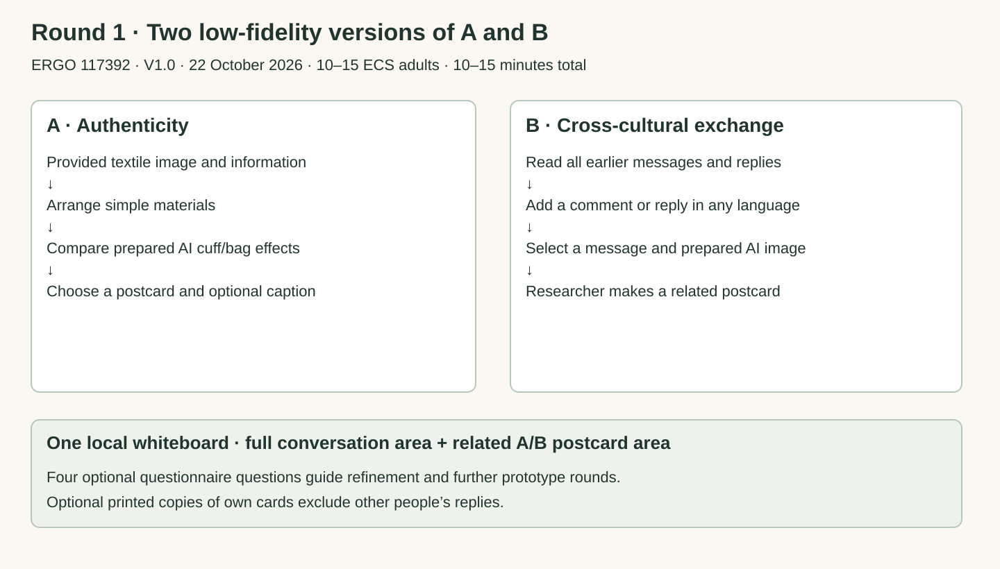

# Round 1 · Low-fidelity prototypes

02 / ROUND 1 · LOW-FIDELITY PROTOTYPESThe first prototype round explores both conceptsA and B are the working probe directions above. Round 1 uses simple materials and prepared examples to gather feedback, refine both directions and support later selection. Its procedure follows ERGO 117392, V1.0, 22 October 2026.

10–15 adultsECS staff or students aged 18 or over. Recruitment begins after ethics approval.

10–15 minutesTry A then B, about three minutes each, followed by four optional questions.

Prepared AI contentThe researcher checks examples before sessions and manually simulates responses and card assembly.

One local whiteboardFull anonymous messages and replies remain in a conversation area, with related A/B postcards in a card area.

A · CONCEPT TO ROUND 1

### Explore authenticity through material arrangement

Concept: material action shapes an AI adaptation and the person’s understanding of authenticity.

Round 1: work from the provided textile image and information. Arrange paper, shapes, fabric or simple objects to express an understanding of it. Compare prepared AI cuff/bag examples, adjust and choose a postcard.

Optional card sentence: “What did you keep or change from the textile source, and why?” Any language is welcome. The researcher can enter the exact words. Question 2 privately reflects on the whole activity.

What this helps us refine: the source-to-arrangement-to-adaptation relationship, what people understand as authentic, and which examples or prompts need improvement.

For later iterations: develop and examine the live AI response to an actual material action.

B · CONCEPT TO ROUND 1

### Explore cultural understanding through messages and related postcards

Concept: AI supports expression and negotiation across cultural perspectives, with a postcard connected to the exchange.

Round 1: read all earlier submitted anonymous messages and replies in their original languages. Add a comment or reply. Select one of your messages and a prepared AI image. The researcher combines the message, source and image into a related postcard.

Conversation and card: both stay on the same local whiteboard in separate areas. The full message history remains readable alongside the postcards. Label AI multilingual starters and exclude them from participant data.

What this helps us refine: how earlier messages, replies and images support expression, understanding and clarification, and how the postcard relates to the conversation.

For later iterations: develop and examine live language and image assistance.

Round 1 only. Prepared content and manual simulation explore the two probe concepts. Participants’ original words remain outside AI services.

### The session

- Read the information sheet, ask questions and tick consent.
- Try Round 1 A, then Round 1 B, about three minutes each.
- Complete the four optional questionnaire questions.
- Check drafts for identifying details and confirm submission. Anonymous messages, replies and cards remain for later participants.
- Choose whether to keep printed copies of your own cards, excluding other people’s replies.

Round 1 data and what the feedback can help us decideRetain: consent tick and questionnaire answers. A: optional caption and source/prepared-image choices. B: original messages, replies, clarifications, reply relationships and links to sources, images and derived postcards.

Retain text and references to existing images. Keep questionnaire answers private. Exclude labelled AI starters from participant evidence. Summarise preferences, reasons and themes about authenticity, cultural expression, understanding and improvements.

This round helps choose what to improve, develop and explore next. Later working-prototype research can specify its own action, generation, translation and recording procedures.

Collection limits for this round: no names, signatures, contacts, demographics, photographs, screenshots, audio, video, observation notes or interaction logs. A’s physical arrangements are not retained.

The four Round 1 questionnaire questions- Which prototype should we develop further for a museum experience? Tick one.
- A: How did working from the textile object and comparing AI examples shape or change your understanding of authenticity? Why?
- B: How did earlier messages, replies and the AI image affect what you expressed or understood across cultural perspectives?
- Why your choice in Q1, and what would you improve in the activities, wall or take-away cards?
Question 1 options: A, B, Both equally, Neither, Not sure.

Round 1 participation and storageParticipants can skip activities or questions, stop, or discard drafts before submission. Submitted anonymous cards and forms cannot subsequently be located for removal. Check drafts before submission.

The whiteboard runs on study equipment without accounts or public access. Lock paper forms and use University-approved secure UK digital storage. Retain data for at least 10 years after collection or publication, whichever is later, then review disposal.

### After Round 1

Use preferences, reasons, captions and conversations to refine A and B. Develop further prototype iterations, reconsider the interaction and AI role, and then select which direction to pursue. The present page records the two concepts and their first low-fidelity round.
