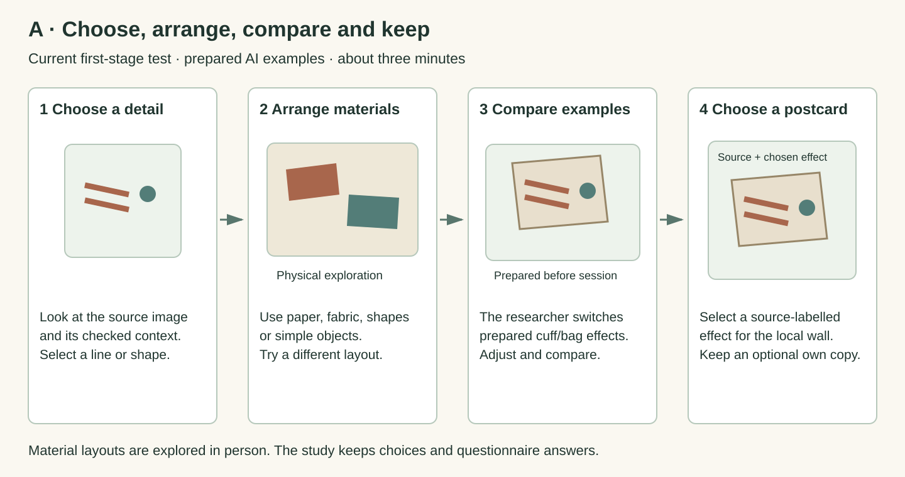

# Direction A · Make with AI on My Cuff or Bag

Developed from Probe 2. About 3 minutes in this test is an estimate.

Choose a source detail, arrange materials, compare prepared AI effects on a cuff or bag picture, then select a postcard.

## Research question

During material arrangement and AI cuff/bag previews, how do participants maintain or revise their sense of authenticity?

A connects three things: a detail from a named heritage object, a material arrangement, and an AI adaptation shown on an everyday-item picture. The questionnaire asks what kept or changed what felt authentic, and why.

## First-stage participant activity

1. **Choose a source detail.** Look at the object image and checked information. Choose a line, shape or other detail to explore.

2. **Arrange materials.** Use paper, shapes, fabric or simple objects to interpret the detail. Help is available.

3. **View a prepared example.** The researcher shows the closest prepared example linking a sample layout and source detail to an AI effect on a cuff or bag picture.

4. **Adjust and compare.** Change the arrangement and compare another prepared example. These images illustrate sample layouts.

5. **Choose your postcard.** Select a card showing the source and preferred effect. The anonymous card joins the shared local wall after submission.

6. **Reflect and keep a copy.** Answer the optional authenticity question. You may take a printed copy of your own postcard.

## AI’s role

AI creates the example adaptations before the session. The researcher checks them, then manually switches between prepared examples during the activity. Participants are told how the simulation works. The example is matched to a sample layout and source detail.

## Participation choices

Participants can skip an activity or question, stop, or discard drafts before submission. A separate non-AI comparison condition is a possible future study design.

## Smallest working set-up

Source images and information for the agreed objects, simple arranging materials, checked prepared AI examples, a screen, a local postcard wall and optional printing.

## Broad participation

No museum or AI expertise is required. Simple materials and researcher help support participation. First-stage recruitment is restricted to adult ECS staff and students who can understand the study information and give consent.

## Theory and HCI

**Connections between people and objects.** Relational authenticity draws attention to connections among people, objects, making and history. In this test, the participant’s written reflection explains which connection mattered. [1]

**Looking alike and having a real link.** A similar shape and knowledge of a maker or history offer different grounds for authenticity. The questionnaire invites participants to describe the grounds they use. [2]

**Action and response.** Embodied-generation precedents motivate the material activity. Prepared examples let this first-stage study explore how people understand the idea and what they want to change. [22] [29] [30]

## Speculative direction for later development

Design possibility for later development: a museum shares changing textile patterns for everyday cuffs and bags. What connections to the source would people want to keep visible?

## Where speculation enters

The book cases help us imagine this arrangement and decide what the examples should communicate. The submitted first-stage protocol uses material exploration, postcard selection and the questionnaire. A separate future-label discussion would belong to a later plan.

## Participant input and data

Keep the selected source-detail and prepared-image references for the submitted A card. The written evidence comes from the anonymous questionnaire. Physical arrangements, photographs, observation notes and interaction logs are outside this first-stage data collection.

## Analysis

Read the authenticity reflections alongside the selected source and example references. Summarise reasons about resemblance, source context, material exploration and personal connection. Compare development preferences and suggestions across the two activities.

## Candidate contribution

This development study helps choose which direction to refine. A later study could examine how source-related judgments develop during a working AI interaction. The current written reflections help identify useful questions and design choices.

## Revision criterion

Use questionnaire reasons and selected-example references to identify unclear steps, meaningful source connections and useful improvements. Record suggestions through the questionnaire.

## Illustrated first-stage guide

### What happens in this first test

Explore a source detail with simple materials, then compare prepared AI effects on a cuff or bag picture. The researcher explains that these are examples made before the session and switches them manually. The activity takes about three minutes.

First-stage activity diagram. Shapes, source patterns and example cards are illustrative. The researcher shows prepared examples.

### Keep the source visible

Use only images and checked collection information for 1–2 objects associated with Tudor House & Garden and God’s House Tower. Each example links a named source detail to a sample material layout and an AI effect on a cuff or bag picture. The source and its background remain visible beside the adaptation. [27] [28]

### Who does what, and what is kept

Plain step names replace the earlier letter codes. Material arrangements remain part of the experience. The research record keeps choices and questionnaire answers.

### Where authenticity enters

Question 2 asks: “A: As you arranged materials and compared the source with AI cuff/bag previews, what kept or changed what felt authentic? Why?”

### Recognising the source

A person might refer to a line, shape, material relationship or known background. Their written explanation tells us which feature mattered. [1] [2]

### A new everyday use

The adaptation appears on a cuff or bag picture. The question invites the participant to explain how this use affected their sense of connection to the object.

### How Art Morph informs the direction

Art Morph connects materials, a camera and generated art. Body-prompting research and A(I)Cam add examples of embodied generation. These motivate A’s longer-term interaction idea. In the current study, prepared examples and questionnaire answers help us decide how to develop it. [22] [29] [30] [31]

The possible research contribution concerns how material exploration and an everyday adaptation affect the grounds people use for authenticity. This first stage helps refine that question and the activity. [1] [2] [12]

[Detailed Huayao evidence and reasoning for A](EVIDENCE_FOR_A.md)

[Original speculation passages](SPECULATION.md) · [Numeric references](SOURCES.md)
