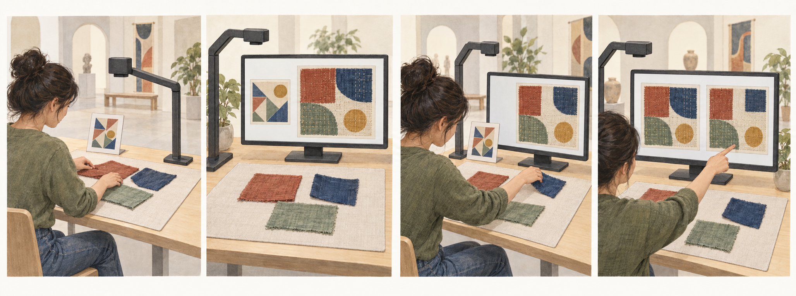

# Direction A · Make with AI

Developed from Probe 2. 8–12 minutes is an estimate.

Arrange ordinary fabric, see an AI image respond, then change the fabric to guide its next response.

## Research question

What makes an AI-transformed design feel connected to its heritage source?

We follow the visitor’s actions and reasons. A result may look similar yet lose something that matters. A visibly different result may still carry a connection the visitor values. Neither outcome is required.

## Visitor activity

1. **Choose a source detail.** See one approved textile image and its short background. Point to a detail you want to work with. No written interpretation is required.

2. **Arrange three pieces.** Place, overlap or fold ordinary fabric on a mat in response to the detail. You may point and direct a helper.

3. **Ask AI to respond.** Press Generate when ready. A camera takes one tabletop image. AI receives this layout and the fixed source crop, then returns one new visual response.

4. **Move after looking.** See the source, your layout and the AI result together. Move one piece if you want a different response. You may also keep the result or stop.

5. **Compare the next response.** Generate once more if you changed the layout. Compare the two rounds. Point to a change that matters and say briefly why.

6. **Reflect and take away.** Discuss what still connects to the source and what has changed. Then try the clearly labelled future-display scenario. Keep a visual record with source credit and AI involvement.

## AI’s role

A visual partner during making. It transforms a visitor’s tabletop arrangement using one fixed heritage image as a reference. The visitor changes the arrangement after seeing the result. AI does not write an account of how the visitor felt.

## The non-AI route

Make and adjust the physical arrangement, compare it directly with the source and keep a labelled collage record. Record why AI was declined. This route supports participation and is not the same interaction or a randomized control condition.

## Smallest working set-up

One approved source crop and fact card, three or four easy-to-grasp fabric pieces, a neutral mat, an overhead camera, one screen and one image-to-image generation service. Start with two snapshots. Keep the source crop and generation settings fixed. No live projection, sewing, custom model training or automatic movement recognition is required.

## Broad participation

Offer seated access, large fabric pieces, pointing and a helper who follows the visitor’s directions. No typing, drawing, sewing or personal phone is needed. A visitor can decline photographs and use a researcher-drawn layout. Explain whether that route sends the drawing to AI. A person may decline AI entirely.

## Theory and HCI

**Connections between people and objects.** Relational authenticity asks how a connection becomes meaningful through objects, people, making and history. We follow the connections visitors themselves describe. [1]

**Looking alike and having a real link.** A similar shape is one possible reason. A known maker, source or history is another. Record these reasons separately. New cloth and generated pixels do not become original heritage material. [2]

**Action and response.** We examine whether a visitor can see how their material action affects AI, guide the next image and decide when the result no longer fits the source. Embodied generation already has published precedents. [22] [29] [30]

## Speculative scenario

Imagine a future museum where a textile’s digital display keeps changing with each visitor’s fabric arrangement and AI response. A label calls every new result “the same work, still changing”. After your own two rounds, would you keep that label, rename the display as a visitor response, or keep the original work separate?

## Where speculation enters

After the ordinary task, place the two actual outputs beside a clearly fictional future-display label. The changed rule is that a continually remade image is presented as the continuing work. The participant may accept, change or reject that rule. The real source image stays unchanged and credited. The generated result is labelled as a visitor response.

## Participant input and data

Record the source and chosen detail, layout photos L1 and L2, actual outputs G1 and G2, the order and reason for a movement, what the participant points to, short explanations, decisions to keep or stop, and answers to the separate future scenario. Record model settings, waiting time, failed responses and researcher help. A camera log alone cannot explain the visitor’s reason.

## Analysis

Read a complete episode: source detail → first layout → AI response → visitor movement or decision to keep → next response → reason linked to the source. Separate liking an image, controlling AI, feeling authorship and claiming a heritage connection. Retain disagreement, no change, helpful surprises, indifference and non-AI choices.

## Candidate contribution

The candidate contribution is an account of how visitors maintain or change their grounds for a connection to one named heritage object during material interaction with AI. The interaction technique has close precedents. A contribution would need evidence from the action sequence and the visitor’s reasons.

## Revision criterion

First check whether visitors notice a relationship between their movement and AI’s response. If the model ignores layout, fix the prototype before drawing conclusions about authenticity. If accounts only concern colour preference or novelty, revise the source detail and reflection prompts.

## Illustrated implementation guide

### The station and the two rounds

You communicate by moving fabric. AI responds with an image while you are making. You can then change the fabric in response to that image. A short conversation happens afterwards so we can understand your choices. Writing a personal explanation is not the task.

AI-generated concept illustration. The artwork-like card and patterns are invented placeholders. This is not a photograph of a study, a target-venue object or evidence that the model will follow every movement.

- Arrange. Put three pieces on a mat. Choose the starting point yourself.

- See. Take a snapshot. Compare AI’s result with your layout and the source.

- Respond. Move a piece because of what you saw, or decide to keep the result.

- Compare. See both rounds. Point to what matters and explain briefly.

At the table: a mat, three or four large fabric pieces, an overhead camera and a screen. The screen has three clearly named areas: Source work, Your layout and AI response. A large Generate button lets the visitor choose when to take each turn. Start with two rounds. Waiting time must be tested.

### A real object with its background

The current textile candidate is a wall hanging from Ian Giles’s Everyone Involved, exhibited at God’s House Tower in 2024. Its use of found and vintage fabrics belongs to a work about LGBTQIA+ history and creative life. The venue says the work would enter Southampton City Art Gallery’s collection. One hanging, image permissions and the chosen detail still need agreement. [28]

Show the whole work, the selected crop, the artist and a short checked background together. Do not turn it into an anonymous “British traditional pattern”. A visitor may respond to a fabric relationship or gap without being asked to disclose personal identity. Tudor House needs a confirmed textile reference or permission to host this GHT-associated digital reference with its actual source named.

### What each turn gives us

The source stays fixed. Each layout and AI output is saved as a separate item. A movement alone does not tell us why the visitor made it.

BEFORE GENERATION

### Choose a detail

Person: points to an edge, overlap or other detail. They may say what drew their attention.

AI: has not responded yet.

Data: source ID, fact-card version, selected area and any first comment. This gives us the person’s starting reference.

ROUND 1

### Layout L1 → image G1

Person: arranges the fabric and presses Generate.

AI: receives the source crop and a photo of L1. It returns one new image, G1, using the layout as a guide.

Data: L1, the actual request, G1, time taken and any help or failure.

ROUND 2

### Layout L2 → image G2

Person: moves a piece after seeing G1. They can instead keep G1 or stop.

AI: receives the same source and the new layout. It returns G2 using the same prompt template and settings.

Data: the change from L1 to L2, what prompted it, G2 and the keep, change or stop decision. A second round is never forced.

SHORT REPLAY

### Point and explain

Person: points to a change across the source, layouts and outputs.

Researcher: asks “What made you move that?” and “What still connects to the source?”

Data: the pointed area and brief explanation. Record the future-scenario response separately.

### Where authenticity becomes a research question

We ask what makes a connection feel real or meaningful to the visitor. The generated image has a known digital source, but the visitor may accept, doubt or ignore its connection to the work. A pleasing picture and a correct source credit are useful observations. Each answers a different question. [1] [2]

### Appearance

Does the person point to a recognisable detail, shape or relationship? Example question: “Which part makes you connect these images?” Similarity can matter, but it does not prove shared history.

### Making and material

Does an overlap, fold or gap matter because of what they did or noticed in the source? New cloth is ordinary activity material. Touching it does not recreate the source work’s past.

### Maker and history

Does the person refer to the artist, the work’s background or a known use of fabric? Keep checked historical information separate from the visitor’s own association. AI must not invent an archival story.

### Personal connection

Does the result bring the source closer to their own life, or make it feel less connected? Ask them to explain. Feeling that “I made this” concerns authorship and may or may not involve the heritage source.

These are starting points for analysis. Participants may give other reasons. We do not turn the four areas into a total authenticity score. We first ask open questions and only follow up on a reason the person has introduced.

A concrete example of an authenticity-related episodeInvented example to explain the design, not participant data. A visitor chooses an overlap in the source and leaves a narrow space between two fabric pieces. G1 fills that space. The visitor moves the pieces farther apart, and G2 leaves it open. They explain: “That space is what made me think of the original. Without it, I liked the picture but lost that connection.”

The useful evidence is the chosen source detail, both layouts, both actual outputs and this reason. A comment such as “blue is nicer” would show preference. “The model ignored my move” would show an interaction problem. Neither comment alone supports a claim about authenticity. Do not deliberately create a wrong response to make this episode happen.

### What is already in Art Morph, and what we could add

Art Morph already lets museum visitors move everyday materials under a camera and see generated art inspired by the collection. Its official description names real-time generation and a collection-adapted SDXL Turbo model. The developer describes images changing with gestures. We therefore cannot claim that physical materials, a museum setting or AI visual feedback are our invention. [22] [29]

### Interaction form

Art Morph documents: material arrangements become collection-inspired generated images.

Our design uses: two deliberate turns, with one named source and both layouts and outputs visible. This makes the sequence easier to discuss and record. Slower snapshots are a practical choice, not a new technique.

### The question being investigated

The public Art Morph pages describe: creative interaction with the collection. They do not report an evaluation of how visitors judge authenticity.

Our candidate study asks: which details and relationships visitors use to maintain or change a connection to one source work while making with AI. The public pages cannot tell us whether unpublished Art Morph evaluation covers this question.

### The evidence needed

A generated image can show: a visual outcome.

Our analysis also needs: the starting source detail, the movement made after G1, G2 and the visitor’s reason. This can show how a reason changes during interaction. A final satisfaction rating would miss that process.

### The possible contribution

A small study could explain when visitors welcome an AI change, correct it or treat it as a separate creation, and what each response rests on. It could guide how museums show sources and visitor contributions in changing displays. These are claims to establish through data and wider comparison.

Published work also covers body-based image generation in public art settings, and CHI 2025’s A(I)Cam used a tangible camera and printed generated images to support reflection. These are close precedents for the interaction form. The Huayao work helps us notice reasons that emerge during making. This targeted comparison does not establish that the proposed authenticity question is untouched. [30] [31] [12]

Smallest build and first checks
AI input: the fixed, permitted source crop and a tabletop photo. Use an image-conditioned generation model. A fixed instruction asks it to use the arrangement as a guide and produce a contemporary visitor response. Do not request a historical reconstruction or add guessed symbols.

Keep steady: the source crop, prompt template, model version, output size and generation strength. Keep the seed fixed if the service supports it. Save all actual settings. Random image differences can still occur, so do not assume every output change was caused by the visitor’s move.

Check action and response first: test moving one large piece while keeping the rest steady. Check whether a visitor can see a useful relationship in the output. If the model repeatedly ignores layouts, try stronger structural guidance before conducting the authenticity study. Log unsuccessful attempts and facilitator help.

First walkthroughs: start with the existing planning estimate of 4–6 people for usability. This is not the final research sample. Ask whether they understand the turns, can decline AI and can explain a specific connection or lack of connection. Only then decide a study scale.

Research record: use a session code. Keep selected snapshots, event times, model and prompt versions, actual outputs, pointed regions and consented short explanations. A still-image sequence is the starting method. Continuous hand video is optional and needs a separate study decision. Keep email addresses out of this record.

[Detailed Huayao evidence and reasoning for A](EVIDENCE_FOR_A.md)

[Original speculation passages](SPECULATION.md) · [Numeric references](SOURCES.md)
