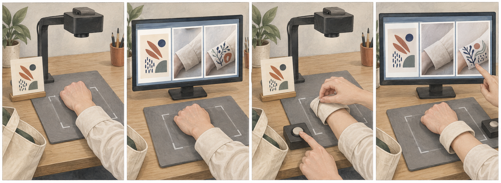

# Direction A · Make with AI on My Cuff or Bag

Developed from Probe 2. 8–12 minutes is an estimate.

Choose a cuff or bag corner, see an AI pattern preview, then fold or reposition the fabric to guide its next response.

## Research question

What makes an AI-adapted pattern on a personal item feel connected to its heritage source?

We follow how a pattern moves from a named source work into someone’s everyday life. A visitor can value a familiar shape, a material relationship, the artist’s story or a personal memory. Their actions and reasons show which connection matters.

## Visitor activity

1. **Choose a source and item.** Look at the named textile work and its background. Point to one detail, then choose a sleeve cuff or bag corner. A plain study item is available.

2. **Frame one local area.** Place the item inside the fixed tabletop window. Check the crop preview, then press Capture. Only this selected crop C1 enters the image request and study record.

3. **See the first response.** AI uses the source detail and C1 to propose a digital pattern adaptation G1 on the local item. The screen keeps the source, captured crop and generated preview visible together.

4. **Respond with an action.** Fold the cuff, flatten a bag edge or reposition the fabric after seeing G1. Capture C2 in the same window when ready. You can also keep G1.

5. **Compare and choose.** AI responds to C2 as G2. Compare the two previews and point to a change that matters. Explain briefly what connects it to the source or your own life.

6. **Discuss and keep a record.** Use the previews and a fictional future label to discuss changing museum works. Keep a visual record with source credit and your selected version.

## AI’s role

A visual partner during the local material action. It proposes a pattern adaptation for the captured cuff or bag area, using a fixed source detail. The visitor’s next fold or position becomes its next input. Added patterns appear in digital previews.

## The non-AI route

Compare the source with the selected local item, try a fold or position and keep a source-labelled local-item record. Record the visitor’s choice and reason. This route contributes accounts of participation and source connection.

## Smallest working set-up

One permitted source detail and fact card, a fixed camera, a small tabletop window, one screen and one image-conditioned generation service. Visitors choose a cuff or bag corner. A plain study cuff or bag panel provides an alternative. Begin with two deliberate captures.

## Broad participation

Offer seated access, a plain study item and a helper who follows the visitor’s directions. People can point, speak or select a prepared outline. Explain and record the chosen capture route. AI use remains a choice.

## Theory and HCI

**Connections between people and objects.** Relational authenticity asks how a connection becomes meaningful through objects, people, making and history. We follow the connections visitors themselves describe. [1]

**Looking alike and having a real link.** A similar shape is one possible reason. A known maker, source or history gives another kind of link. The personal item and original work each retain their own materials and histories. [2]

**Action and response.** We examine whether a visitor can see how their material action affects AI, guide the next image and decide when the result no longer fits the source. Embodied generation already has published precedents. [22] [29] [30]

## Speculative scenario

Imagine a museum that shares a textile work as changing digital patterns for visitors’ own cuffs and bags. Its label says “Each version continues the original work”. Looking at your two previews, what would you keep, change or rename in that museum?

## Where speculation enters

The two actual previews and the clearly fictional label make this future museum concrete. Visitors can discuss how personal use carries a source forward, what should remain recognisable and how the artist and source should be credited. Their own answer guides the discussion.

## Participant input and data

Save source S and its selected detail, item type and capture route, approved crops C1 and C2, actual previews G1 and G2, the action between them, pointed regions, brief reasons and keep or stop decisions. Record model settings, timing, help and failures. Keep future-scenario answers as a separate part of the session.

## Analysis

Follow S → C1 → G1 → action → C2 → G2 → reason. Read how the visitor relates a change to the source and the personal item. Analyse visual preference, useful control, authorship and source connection as separate judgments. Include choices to keep, stop or use another input route.

## Candidate contribution

The candidate contribution is an account of how visitors maintain or change their grounds for a connection to one named heritage object during material interaction with AI. The interaction technique has close precedents. A contribution would need evidence from the action sequence and the visitor’s reasons.

## Revision criterion

First establish that visitors can see a useful relationship between their local action and the next preview. Then examine whether their reasons refer to the source work, its context, the item or personal experience. Use pilot observations to improve structural guidance and reflection prompts.

## Illustrated implementation guide

### One small place to interact

Place a sleeve cuff or bag corner inside a fixed capture window. Both A and B use this station. Check the local preview and press Capture. The system crops to the selected window before AI input or storage. A plain study item, prepared photograph or outline offers another way to join.

AI-generated concept illustration with invented source patterns. Added patterns appear in screen previews. A bag corner uses the same station.
- Frame. Approve local crop C1.
- See. AI uses source S and C1 to propose G1.
- Act. Fold or reposition, then capture C2.
- Compare. Point to a meaningful change in G2.

Starting set-up: a fixed camera, an approximately 20 × 20 cm tabletop window, one screen and a Capture button. The screen keeps the source, approved local crop and generated preview side by side. Pilot sessions establish the useful window size and waiting time.

### A named work enters everyday life

The current textile candidate is a wall hanging from Ian Giles’s Everyone Involved, exhibited at God’s House Tower in 2024. Its found and vintage fabrics belong to a work about LGBTQIA+ history and creative life. The venue states that it would enter Southampton City Art Gallery’s collection. Agree one hanging, its usable image and a detail with the relevant people. Show the artist and short checked background beside the crop. [28]

The visitor considers what this detail could mean on their own cuff or bag. The work’s documented background and the visitor’s associations remain clearly identified. Tudor House can host the same permitted digital reference with its actual source named, or use a confirmed textile reference of its own.

### Person, AI and data in each turn

Keep the source and local item linked across both turns. Join each action to the actual AI output and the visitor’s reason.

START

### Choose the detail and item

Person: points to an edge, line, overlap or other feature, then chooses a cuff or bag area.

AI: waits for the approved input.

Data: source ID, chosen detail, fact-card version, item and capture route, first comment.

FIRST TURN

### C1 → G1

Person: checks the crop and presses Capture.

AI: proposes a pattern adaptation using C1 and the fixed source.

Data: approved C1, actual request, G1, waiting time and help.

NEXT TURN

### Action → C2 → G2

Person: folds a cuff, flattens an edge or changes position after G1. Keeping G1 or stopping are also choices.

AI: responds to C2 with the same source and settings.

Data: physical change, C2, G2, keep or stop decision and any problems.

SHORT REPLAY

### Point and explain

Person: points across the source and previews.

Researcher: asks “What made you change that?” and “What still connects to the source?”

Data: pointed area, brief reason and separately labelled future-scenario answers.

### How authenticity enters the activity

Ask what makes the source connection feel real or meaningful. The pattern enters a familiar personal item. Follow how the visitor relates this use to the source, its maker, its materials and their own life. [1] [2]

### A recognisable relationship

The visitor may value a repeated line, gap or overlap. Ask which feature links the preview to the source. Appearance gives one kind of reason.

### A material action

A fold can give a pattern a personal use or make a relationship visible. The original textile and personal item each retain their own material history. Ask how the action relates them.

### Maker and context

Someone may refer to the artist’s choices or the work’s background. Record checked context and personal association separately.

### A place in my life

The visitor may imagine carrying or wearing the adaptation. Ask what this changes in their relationship with the source. Ownership, authorship and heritage connection can develop in different ways.

Use these as starting points for analysis. Begin with open questions and follow the reasons the visitor introduces.

A worked exampleInvented example. A visitor selects parallel lines in the source. G1 merges them on the cuff. They fold the cuff to make an edge clearer and request G2, then explain: “Those two lines connect it to the work for me. I want to keep them when I wear it.” Read this account beside S, C1, G1, the action, C2 and G2.

An explanation about a favourite colour concerns preference. An ignored fold concerns control. A reason tied to the chosen source concerns the heritage connection. Keep these accounts distinct.

### How Art Morph helps us develop A

Art Morph connects physical materials, a camera and collection-inspired generated images. Its developer describes responses to gestures. This is a close practical starting point for A. [22] [29]

### Our everyday setting

A keeps one source and one local item in view. A fold or position change guides its next pattern preview.

### A clear sequence

Two deliberate captures make the turns manageable. Keep both actual responses and the action between them.

### A source-related reason

Follow why a visitor welcomes a change, keeps a particular feature or sees the result as a new personal creation.

### Possible contribution

The study could explain how a heritage work enters personal life through material interaction with AI, and guide source credit, visitor control and changing museum displays.

The official Art Morph pages describe its creative interaction. Body-prompting research and CHI 2025’s A(I)Cam add embodied-generation precedents. A’s focused authenticity question and action-and-reason record are the contribution to investigate through the study and wider literature comparison. [30] [31] [12]

Build and pilotCapture: approve the small window, crop before AI input and storage, and keep the same item across turns. Record whether the input is a personal item, study item, prepared photograph or outline.

Generation: keep the source, prompt template, model version, size and strength steady. Use a fixed seed when supported. Save the original crop and actual generated preview separately. Log random differences, structural errors, timing and assistance.

First check: establish that a clear local action gives a response a visitor can understand and guide. Then examine the source-related reasons. Start with 4–6 usability walkthroughs as a planning estimate and use the observations to plan the research sample.

[Detailed Huayao evidence and reasoning for A](EVIDENCE_FOR_A.md)

[Original speculation passages](SPECULATION.md) · [Numeric references](SOURCES.md)
