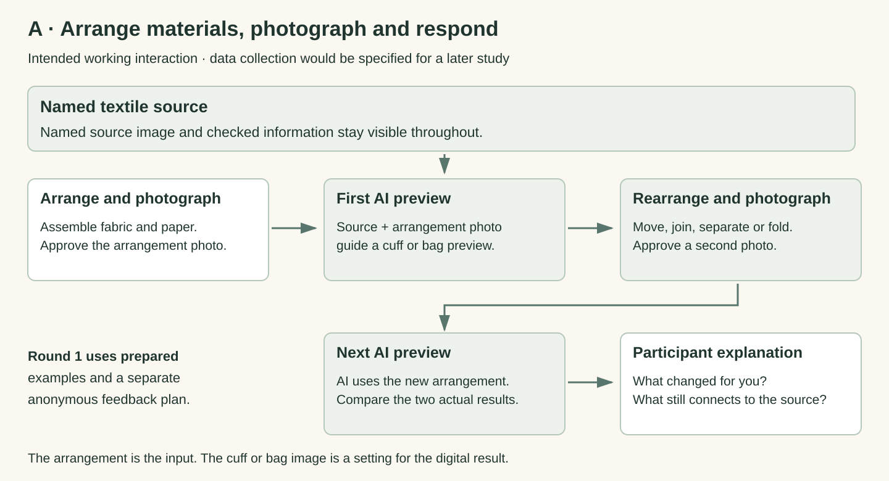

# Direction A · Make with AI on My Cuff or Bag

Developed from Probe 2. Working concept under iterative development. See [Round 1](FIRST_STAGE_TEST.md) for the first low-fidelity implementation.

Explore a source pattern on a cuff or bag, respond to the AI preview with a material action, then compare what changes.

## Research question

How do people maintain or revise their understandings of authenticity through interaction with AI and cultural heritage?

A explores how material actions and AI image responses affect a person’s understanding of authenticity. A named textile object supplies the source. The cuff or bag is one everyday way to encounter its patterns.

## Intended probe interaction

1. **Choose a source and item.** Read the textile object’s information and select a detail. Choose a cuff or bag area, with a study item available.

2. **Approve a small photograph.** Place the chosen area in the fixed tabletop window. Check and approve the local photograph.

3. **See AI’s first preview.** AI combines the source detail and approved photograph to propose a digital pattern preview.

4. **Make a physical response.** Fold, flatten or reposition the material after seeing the preview. Approve another local photograph, or keep the current result.

5. **Compare and explain.** Compare the two actual previews. Point to a change and explain what it carries from the source or your own experience.

6. **Reflect and keep the result.** Discuss the clearly labelled future museum arrangement and keep a source-credited visual record.

## AI’s role

In the working concept, AI adapts a named source pattern to an approved local cuff or bag photograph. The person’s next fold or position change becomes the next input. The source, photograph and AI preview remain visible together.

## Participation choices

The concept includes a route using the source and local item without generation. The person can keep a plain source-labelled record. Round 1 separately permits skipping or discarding drafts under its submitted protocol.

## Smallest working set-up

One permitted source detail and fact card, a fixed camera, a small tabletop window, one screen and one image-conditioned generation service. Visitors choose a cuff or bag corner. A plain study cuff or bag panel provides an alternative. Begin with two deliberate captures.

## Broad participation

Offer seated access, a plain study item and a helper who follows the visitor’s directions. People can point, speak or select a prepared outline. Explain and record the chosen capture route. AI use remains a choice.

## Theory and HCI

**Connections between people and objects.** Relational authenticity asks how a connection becomes meaningful through objects, people, making and history. We follow the connections visitors themselves describe. [1]

**Looking alike and having a real link.** A similar shape is one possible reason. A known maker, source or history gives another kind of link. The personal item and original work each retain their own materials and histories. [2]

**Action and response.** We examine whether a visitor can see how their material action affects AI, guide the next image and decide when the result no longer fits the source. Embodied generation already has published precedents. [22] [29] [30]

## Speculation in the probe concept

Imagine a museum that shares a textile work as changing digital patterns for visitors’ own cuffs and bags. Its label says “Each version continues the original work”. Looking at your two previews, what would you keep, change or rename in that museum?

## Where speculation enters

The two actual previews and the clearly fictional label make this future museum concrete. Visitors can discuss how personal use carries a source forward, what should remain recognisable and how the artist and source should be credited. Their own answer guides the discussion.

## Participant input and data

For a later working-prototype study, a proposed record could link the source, approved photographs, AI previews, physical adjustments and participant explanations. The collection method would be specified in that study’s protocol. Round 1 uses the smaller, separate data set described below.

## Analysis

The working-prototype research would follow how people connect their actions, AI responses, the source work and their own experience. Round 1 first gathers written authenticity reflections, optional captions and source/image choices.

## Candidate contribution

The candidate contribution is an account of how visitors maintain or change their grounds for a connection to one named heritage object during material interaction with AI. The interaction technique has close precedents. A contribution would need evidence from the action sequence and the visitor’s reasons.

## Revision criterion

Use Round 1 feedback to refine the task, examples and research prompts. Later iterations can test the live action-and-response loop and choose a detailed study method.

## Working concept guide

### The working A concept

A person’s material action guides AI’s next visual response. Place one cuff or bag area in a small fixed camera window. Keep the named source, approved local photograph and AI preview visible together. A study item or prepared input offers another way to join.

Working concept diagram with illustrative patterns. It explains the intended action-and-response loop. Round 1 uses the prepared examples described below.

### Plain steps in the intended interaction

The earlier letter codes have been replaced by names. Photographs and model responses belong to the working concept. This round’s collection limits are specified in Round 1.

### How authenticity enters A

Ask what the person keeps or changes in their understanding of authenticity as the source pattern enters a new material and personal setting. They may draw on resemblance, a maker’s history, a material relationship or something from their own life. Treat liking, control and authenticity as separate judgments. [1] [2]

### The connection to Art Morph

Art Morph already links physical materials, a camera and generated images. A builds its research focus around a named heritage source and people’s reasons for maintaining or revising what feels authentic. The potential contribution is an account of that process, developed through iterative research. Body Prompting and A(I)Cam provide further embodied-generation precedents. [22] [29] [30] [31]

First prototype round: see how prepared examples and material arrangement explore A in Round 1 →

[Detailed Huayao evidence and reasoning for A](EVIDENCE_FOR_A.md)

[Original speculation passages](SPECULATION.md) · [Numeric references](SOURCES.md)
