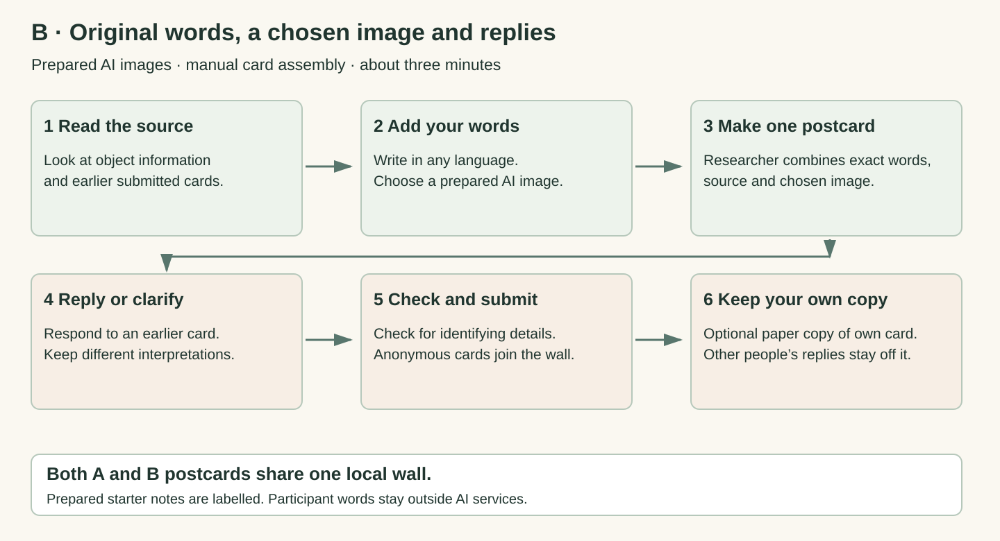
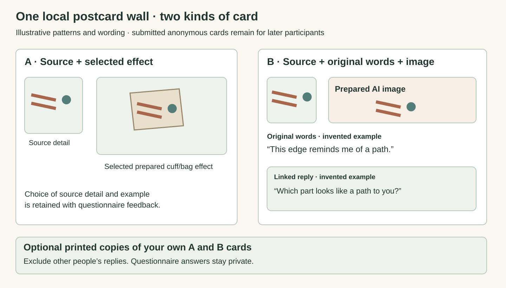

# Direction B · One Object, Two Interpretations

Combines Probes 4 and 5. Working concept under iterative development. See [Round 1](FIRST_STAGE_TEST.md) for the first low-fidelity implementation.

Exchange interpretations of the same object across languages, clarify the meaning, and develop a postcard that carries the exchange forward.

## Research question

How do people express and negotiate their understanding of a shared heritage object through AI-mediated cross-cultural exchange?

B explores expression and negotiation across cultural perspectives. The shared object anchors the conversation. AI offers language and image assistance, while original messages, real replies and clarifications remain visible. A related postcard develops from the exchange.

## Intended probe interaction

1. **Share one named object.** Use the same object image, selected detail and checked information. An approved cuff or bag photograph can provide a personal visual setting.

2. **Express an interpretation.** Write or say what the object means to you in your own language. Check the original words.

3. **Develop and share a draft.** AI assists with translation and a source-related image preview. Original words, labelled translation and source remain visible.

4. **Receive a real response.** Another person reads the source and interpretation, then replies, asks a question or offers a different reading.

5. **Clarify and update.** Keep the conversation visible. Clarify the words and, when useful, revise the associated image and postcard. Different interpretations can remain.

6. **Keep a connected postcard.** Choose the postcard linked to the exchange. The concept includes download or optional email delivery, with the delivery method to be specified for a later study.

## AI’s role

In the working concept, AI bridges languages and helps visualise an interpretation. It can assist a translation or image revision after a real response. People check their own expression and retain the original messages and conversation.

## Participation choices

Use direct language skills or study-team translation and a plain postcard showing the source, local-item reference and checked words. The real reply and clarification still develop that same card. Choose translation, image generation and delivery separately.

## Smallest working set-up

A shared digital source, a conversation interface, language and image assistance, a real reply channel and a linked postcard view. A local cuff/bag image can use the same small capture station as A. The implementation and delivery method will develop through later iterations.

## Broad participation

The concept supports different languages, individual participation, help with input and a plain-card route. Round 1 starts with adult ECS staff and students, using prepared content and a local whiteboard.

## Theory and HCI

**Relational authenticity.** Follow how the object, a person’s experience and the other visitor become connected through exchange. [1] [16]

**Personal voice and recognition.** Separate the sender’s endorsement of wording, the recipient’s understanding, historical accuracy and the recognition of an interpretation. [3] [17]

**Agency and cultural expression.** Being able to change a translation can help people express themselves. It can also make a conversation take more effort. AI writing suggestions may remove cultural details. These findings help us choose what to observe. [8] [9] [10]

## Speculation in the probe concept

Imagine a future museum that shows the final AI-assisted postcards as visitors’ interpretations of an object. Which parts of your developing card should the next visitor see: the final version, the earlier draft and reply, or both?

## Where speculation enters

Use the actual draft, real reply and final card beside a fictional future-display label. Participants decide how a museum should show a meaning that developed through conversation, and whose words or images should remain visible. The real source and each contributor remain identified.

## Participant input and data

A later working-prototype study could link original messages, translations, real replies, clarifications and related postcard versions. Approved local photographs and delivery choices would need their own specified handling. Round 1 collects the anonymous text and existing-image references listed in its protocol.

## Analysis

The working concept asks how meanings travel through expression, AI assistance, another person’s reply and clarification. Round 1 uses original messages, reply relationships, related postcards and questionnaire reflections to refine that activity.

## Candidate contribution

The candidate contribution is an account of how a source-related personal meaning develops through a multilingual conversation around one AI-assisted visual postcard. Its draft and revision show how people recognise, question and clarify each other’s interpretations. The final card keeps the outcome of that same process.

## Revision criterion

Use Round 1 to improve the conversation and postcard relationship. Later iterations can test live language and image assistance and specify the study procedure.

## Working concept guide

### The working B concept

AI helps people express and negotiate interpretations of the same object across languages and cultural perspectives. Original messages, real responses and clarifications remain visible. A related visual postcard carries a selected interpretation from the exchange.

The exchange and postcard are connected. The conversation remains available alongside its related visual outcome.

### A postcard grows from the exchange

Use one selected message as the link between conversation and postcard. AI can assist a translation or image preview. After another person responds, the author can clarify the meaning and revise the associated card. Original words, translations and source information remain identified.

Illustrative layout with invented messages and patterns. The card links to a message. The full conversation remains visible alongside it.

### What B investigates

B focuses on cross-cultural expression, understanding and negotiation. A person may recognise their own voice, encounter a different interpretation or clarify a detail. Relational authenticity and work on personal voice help distinguish these experiences from historical accuracy and translation fluency. [1] [3] [8] [9] [17]

### Keeping the outcome

The working concept includes a personal postcard people can retain after the exchange. Download or optional email delivery can be developed with an appropriate later procedure. Round 1 offers paper copies of participants’ own cards and collects no contacts. [15] [26]

First prototype round: see the local conversation and prepared-image postcard used in Round 1 →

[Original speculation passages](SPECULATION.md) · [Numeric references](SOURCES.md)
