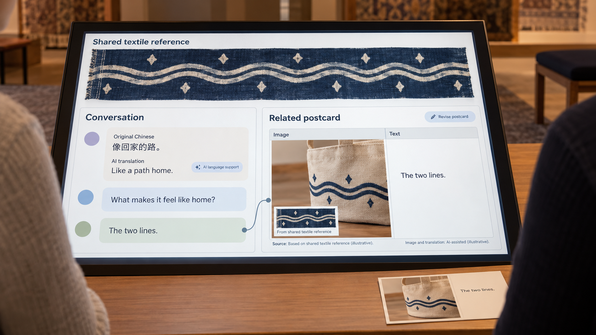
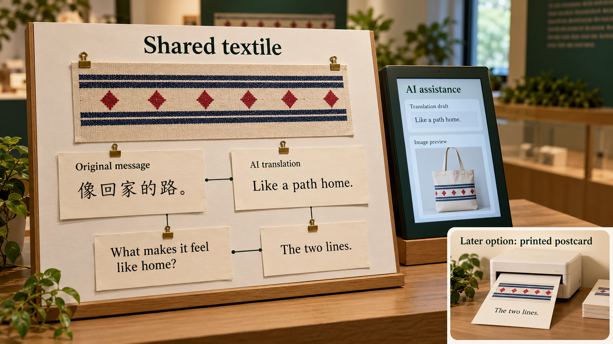

# Direction B · One Object, Two Interpretations

Combines Probes 4 and 5. Working concept under iterative development. See [Round 1](FIRST_STAGE_TEST.md) for the first low-fidelity implementation.

Exchange interpretations of the same object across languages, clarify the meaning, and develop a postcard that carries the exchange forward.

## Research question

How do people express and negotiate their understanding of a shared heritage object through AI-mediated cross-cultural exchange?

B explores expression, understanding and negotiation around one shared heritage object. People contribute interpretations, receive real replies and clarify meaning with AI language and image assistance. A related postcard develops from the conversation. The exchange can use a digital interface or paper notes with a small AI screen.

## Intended probe interaction

1. **Share one named object.** Use the same named object image, selected detail and checked information. Display them on a screen or on a physical board.

2. **Express an interpretation.** Write or say what the object means to you in your own language. Use a message field or a paper note. Check the original words before any AI assistance.

3. **Develop and share a draft.** AI assists with a translation and a source-related image preview. Check the wording and image. Keep original words and labelled assistance together on screen or on adjacent paper notes.

4. **Receive a real response.** Another person reads the source and your interpretation, then replies or asks a question. They may use the interface or add a connected paper note. Different cultural perspectives can meet in one place.

5. **Clarify and update.** Keep the conversation visible. Clarify your meaning after the reply and, when useful, revise the associated image. Select your own message to connect the exchange to a postcard. Different interpretations can remain.

6. **Keep a connected postcard.** Keep a visual postcard linked to the source and your selected message. Later implementation options include a digital copy and a printed postcard. A printer is a possible future addition. Delivery arrangements will be specified for that stage.

## AI’s role

AI bridges languages and helps visualise an interpretation. People check suggested translations and images, receive a real human reply and clarify their meaning. This role can work through a digital interface or a small screen beside a physical conversation board.

## Participation choices

Use direct language skills or study-team translation and a plain postcard showing the source, local-item reference and checked words. The real reply and clarification still develop that same card. Choose translation, image generation and delivery separately.

## Smallest working set-up

Two implementation options share the same interaction: a digital conversation interface, or a physical board with paper messages and a small AI-assistance screen. In the hybrid option, the participant or facilitator enters the chosen words for AI, the participant checks the result, and the original note stays visible. A cuff/bag image can be an optional visual setting. A printer may be added in a later version.

## Broad participation

Offer paper or digital expression, different languages, help with input and participation without a personal device. People can respond to an earlier contribution or a person present. A later digital version can retain a paper entry route.

## Theory and HCI

**Relational authenticity.** Follow how the object, a person’s experience and the other visitor become connected through exchange. [1] [16]

**Personal voice and recognition.** Separate the sender’s endorsement of wording, the recipient’s understanding, historical accuracy and the recognition of an interpretation. [3] [17]

**Agency and cultural expression.** Being able to change a translation can help people express themselves. It can also make a conversation take more effort. AI writing suggestions may remove cultural details. These findings help us choose what to observe. [8] [9] [10]

## Speculation in the probe concept

Imagine a future museum that shows the final AI-assisted postcards as visitors’ interpretations of an object. Which parts of your developing card should the next visitor see: the final version, the earlier draft and reply, or both?

## Where speculation enters

Use the actual draft, real reply and final card beside a fictional future-display label. Participants decide how a museum should show a meaning that developed through conversation, and whose words or images should remain visible. The real source and each contributor remain identified.

## Participant input and data

A later working-prototype study could link original messages, translations, real replies, clarifications and related postcard versions. Approved local photographs and delivery choices would need their own specified handling. Round 1 collects the anonymous text and existing-image references listed in its protocol.

## Analysis

The working concept asks how meanings travel through expression, AI assistance, another person’s reply and clarification. Round 1 uses original messages, reply relationships, related postcards and questionnaire reflections to refine that activity.

## Candidate contribution

The candidate contribution is an account of how a source-related personal meaning develops through a multilingual conversation around one AI-assisted visual postcard. Its draft and revision show how people recognise, question and clarify each other’s interpretations. The final card keeps the outcome of that same process.

## Revision criterion

Use Round 1 to improve the conversation and postcard relationship. Later iterations can test live language and image assistance and specify the study procedure.

## Working concept guide

### Full B concept · Exchange, clarify and keep a result

AI helps people express and negotiate interpretations of the same object across languages and cultural perspectives. Original messages, real responses and clarifications remain visible. A related visual postcard carries a selected interpretation from the exchange.

AI-generated illustrative mockup. Working B concept: AI language assistance supports an exchange, and a selected message links the conversation to its postcard. The textile patterns and messages are invented. Click to enlarge.
- Express: keep the original message beside the AI-assisted translation.
- Reply: another person asks or offers a different interpretation.
- Carry forward: clarify the meaning and update its related postcard.
Open B’s step-by-step diagramThe exchange and postcard are connected. The conversation remains available alongside its related visual outcome.

### A postcard grows from the exchange

Use one selected message as the link between conversation and postcard. AI can assist a translation or image preview. After another person responds, the author can clarify the meaning and revise the associated card. Original words, translations and source information remain identified.

Open the conversation-to-postcard layout sketchIllustrative layout with invented messages and patterns. The card links to a message. The full conversation remains visible alongside it.

### Two ways to host the same exchange

### Digital version

A screen holds the source, original messages, labelled AI assistance, replies and related postcards. People can follow and clarify the conversation in one place.

### Paper board with AI assistance

Place the source and original paper notes on a physical board. A small screen provides translation and image assistance. The participant or facilitator enters chosen words, then the participant checks the result. Keep the original note beside the labelled translation and connect paper replies visibly.

Both forms follow expression, AI assistance, a real reply and clarification. A digital version can develop over later iterations while retaining a paper route for people who prefer it.

AI-generated illustration of a future B option. Paper notes carry the conversation and a small screen supplies AI assistance. The printer inset shows a possible later addition. Patterns and messages are invented. Round 1 follows the submitted local-whiteboard procedure. Click to enlarge.

### What B investigates

B focuses on cross-cultural expression, understanding and negotiation. A person may recognise their own voice, encounter a different interpretation or clarify a detail. Relational authenticity and work on personal voice help distinguish these experiences from historical accuracy and translation fluency. [1] [3] [8] [9] [17]

### Keeping the outcome

A personal postcard can carry a selected interpretation after the exchange. A later version could provide a digital copy or a printed postcard. An on-site printer is one future option. Round 1 permits optional paper copies of participants’ own cards. Its protocol describes manual card assembly and leaves the printing arrangements to preparation. Instant printing is not a promised Round 1 feature. [15] [26]

First prototype round: see the local conversation and prepared-image postcard used in Round 1 →

[Original speculation passages](SPECULATION.md) · [Numeric references](SOURCES.md)
